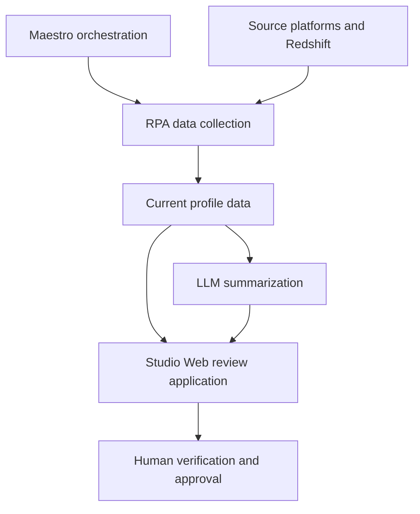

# Customer profile aggregation & AI summarization

**Production case study · UiPath RPA, Maestro, Studio Web and LLM agents**

[Back to my GitHub profile](https://github.com/Mr-Span) · [Portfolio overview](https://mr-span.github.io/claux-cv/work/automation/) · [LinkedIn](https://www.linkedin.com/in/claudiuspan)

## The operational problem

Reviewing a customer profile required a person to collect and verify information across **three platforms** and run **eight Redshift scripts**, alongside the existing process. The earlier workflow refreshed information twice a day, once in the morning and once in the afternoon.

The work combined data collection, checking the results and assembling the context needed for a review. The goal was to bring current information into one place and support the person checking it with an AI-generated summary.

## My contribution

I built the following parts of the production solution:

- **UiPath Studio Web review application:** the interface for human intervention, populated with the collected data, charts, reports and tables.
- **Two key UiPath RPA processes:** important parts of the automated collection and processing workflow.
- **Maestro orchestration:** the flow coordinating the automation and review steps.
- **LLM agent configuration:** prompts, validations and tests for the summarization workflow.

This case sits within my wider delivery of **40+ distinct automation workflows**, covering stakeholder discovery, AS-IS/TO-BE process analysis, design, implementation and hypercare. That number describes my automation work overall.

## How the workflow fits together

The automation collects current information, the LLM agents prepare summaries, and the Studio Web application presents the results alongside the collected data. A human reviewer checks the information and gives approval.

The following is a simplified representation of the workflow, with generic source names:

The review interface combines the structured information and the generated summary so the operator can inspect the result in context. Human approval is part of the production workflow.

## Reported outcome

The solution reduced the operator's time spent collecting and verifying the information by **approximately 70% compared with the previous process**. The comparison concerns the person's work across the source platforms, Redshift scripts and earlier workflow.

Reviewers also receive current data instead of relying on the earlier two scheduled daily refreshes. This describes data freshness in the operational workflow; no latency service-level target is claimed here.

The percentage is a reported operational result. It describes manual collection and verification effort, rather than model accuracy or a general reduction in all business-processing time. Exact internal timings, sample sizes and raw measurement records are not included in this public account.

## Human review and data handling

Customer PII is processed within the enterprise environment. The human-in-the-loop step lets an operator inspect the collected data and the generated summary before confirming correctness.

This public case study describes my contribution using generic workflow names. Employer source code, customer records, prompts containing private data, internal queries and production screenshots remain private. The interactive automation scene in my portfolio is an illustrative demonstration.

### Illustrative review excerpt

The following example is entirely synthetic and demonstrates the review concept; it is not a production data schema:

- **Reference:** DEMO-001.
- **Collection state:** Source A and Source B available; Source C awaiting review.
- **Draft summary:** Two source records are available. The remaining source needs review before the operator confirms the profile.
- **Human decision:** Pending.

## Engineering focus

UiPath RPA · Studio Web · Maestro · LLM agents · prompt design · validation and testing · human review · enterprise data integration · Amazon Redshift.

For more about my work, visit [CLAUX](https://mr-span.github.io/claux-cv/) or [connect on LinkedIn](https://www.linkedin.com/in/claudiuspan).
